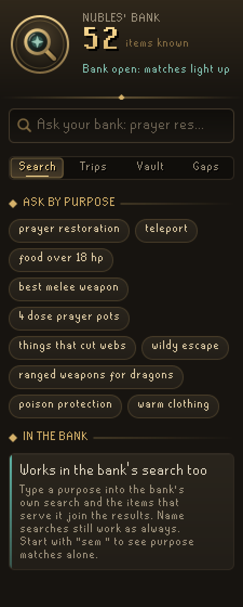
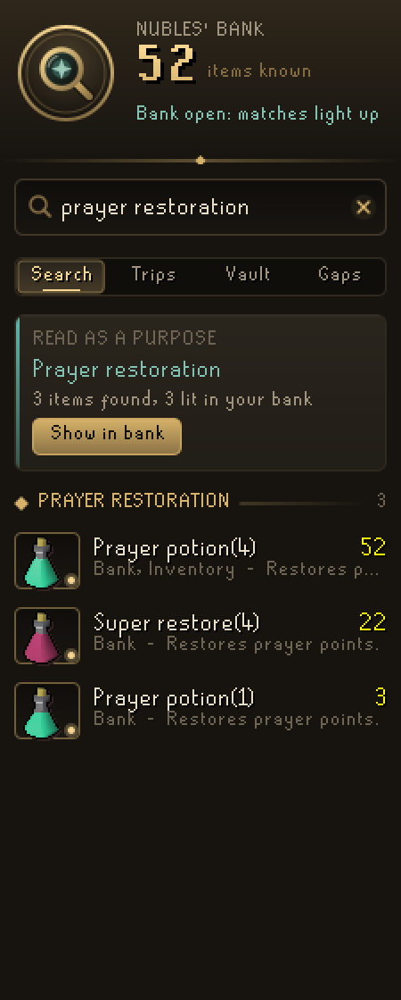
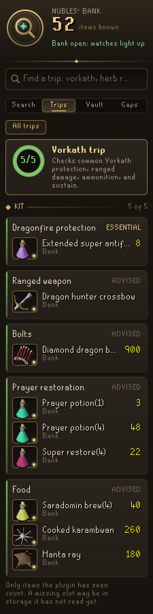
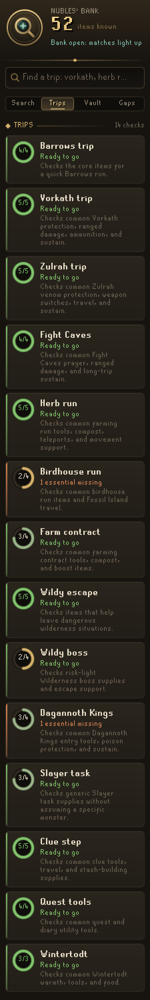
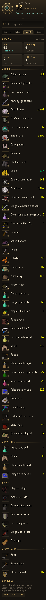
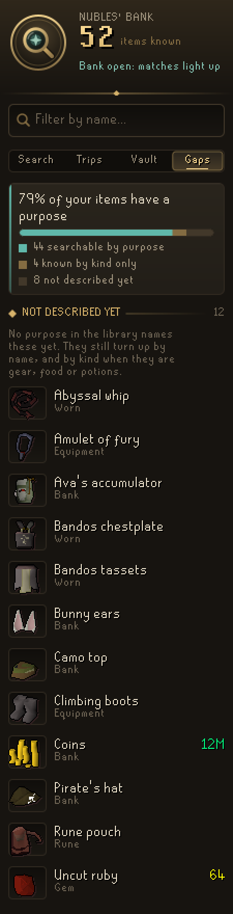

# Semantic Bank Search

Search what you own by what it is for. Type **prayer restoration**, **food over 18 hp**, **best melee weapon** or **things that cut webs** and the plugin finds the items in your bank that serve it, says why each one fits, and lights them up in gold.

It works in two places:

- **The bank's own search.** Type a purpose into the bank search and the items that serve it join the results. Ordinary name searches work exactly as they always have, letter by letter; the plugin only ever adds items, never hides one. Start with `sem ` (for example `sem food`) to see purpose matches alone.
- **The side panel.** Ask from anywhere, bank open or not, and check your kit for a trip.

## The panel

**Search** reads your question the same way the bank does, so the two always agree. It understands:

| You type | It finds |
| --- | --- |
| A purpose: `prayer restoration`, `poison protection`, `warm clothing`, `wildy escape` | Items the purpose library says serve it |
| A kind: `weapons`, `armour`, `food`, `potions`, `prayer gear`, `teleport` | Items whose own game data says so |
| A measure: `food over 18 hp`, `prayer gear at least +5` | Items that clear the bar, from RuneLite's item stats |
| A comparison: `best food`, `best melee weapon`, `best prayer gear` | The strongest you own |
| A combination: `4 dose prayer pots`, `ranged weapons for dragons` | Items that meet every part |
| A name, typos and all: `barows teleprt` | Items by name |

Every result says which purpose it matched and why, where it is kept (bank, inventory, worn, seed vault, group storage) and how many you have. With the bank open, **Show in bank** puts the same search into the bank.

**Trips** checks your kit for Barrows, Vorkath, Zulrah, the Fight Caves, Dagannoth Kings, Wintertodt, herb and birdhouse runs, farming contracts, Slayer tasks, clue steps, quests and Wilderness trips. Each trip shows a ring of how much you already hold, and each slot lists your best items for it or says plainly what is missing.

**Vault** lists everything the plugin remembers, place by place, with when each place was last read.

**Gaps** shows which of your items no purpose describes yet. They still turn up by name.

## What it remembers

The plugin learns what you own by seeing it: the bank when you open it, your inventory and worn gear, and the seed vault and group storage when you use them. Each account's picture is kept in RuneLite's per-account settings, so you can search your bank while it is closed. Turn off **Remember storage** to search only what is open, or use **Forget this account** on the Vault page.

Storage the game never shows RuneLite (the POH costume room, for example) is not guessed at. A trip slot marked missing may be in storage the plugin has not seen.

## Safety

Semantic Bank Search only reads and highlights. It does not click, withdraw, deposit, move or tag items, does not change menus, and makes no network requests. The purpose library is bundled with the plugin.

## Contributing

See [Contributing](CONTRIBUTING.md) and the [Semantic Coverage Guide](docs/SEMANTIC_COVERAGE.md) for adding purposes.
